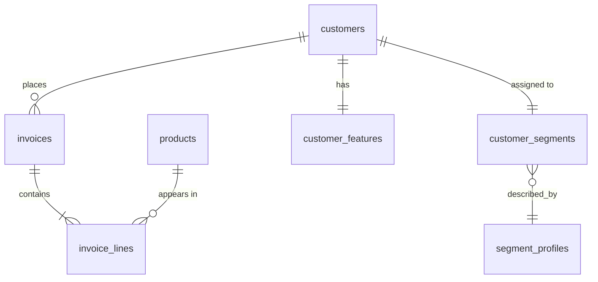
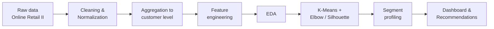

<div align="center">

# 🛍️ Customer Segmentation & Campaign Analytics

### Turning raw transactions into customer segments that marketing can actually act on


[Problem](#-problem-statement) • [Objectives](#-project-objectives) • [Questions](#-business-questions) • [Dataset](#-dataset) • [Database](#-database-design) • [Dashboard](#-dashboard-plan) • [Tools](#-tools--tech-stack) • [Structure](#-repository-structure)

</div>

---

## 📌 Problem Statement

A retail company treats every customer the same way, even though their buying behavior differs widely. As a result, campaigns are broad, discounts reach customers who would have bought anyway, and high-value or at-risk customers get no special attention. Marketing needs **meaningful customer segments** to support different campaigns.

This project uses **unsupervised learning (K-Means clustering)** on customer transaction data to group customers by their **behavioral and transactional characteristics**, then translates each group into clear business recommendations.

---

## 🎯 Project Objectives

1. **Prepare** transaction data: clean, normalize and aggregate it into one row per customer.
2. **Engineer** customer-level features (RFM and beyond) that describe buying behavior.
3. **Segment** customers with K-Means, choosing the number of clusters with the Elbow and Silhouette methods.
4. **Profile and interpret** each segment in business terms (who they are, what they are worth, how to treat them).
5. **Deliver** an interactive dashboard and campaign recommendations marketing can use directly.

---

## ❓ Business Questions

| # | Question |
|---|----------|
| 1 | Who are our **most valuable customers**, and how much revenue do they generate? |
| 2 | How many **natural customer groups** exist based on recency, frequency and spend? |
| 3 | Which customers are **at risk of churning** (high past value, long time since last purchase)? |
| 4 | Which segments are **new or growing** and worth nurturing with onboarding or loyalty offers? |
| 5 | How do **basket size, order value and product mix** differ between segments? |
| 6 | Which **countries** concentrate each segment? |
| 7 | Where is **seasonality** strongest, and which segments drive the peaks? |
| 8 | Which campaign type fits each segment (retention, win-back, upsell, loyalty, discount)? |

---

## 📦 Dataset

| Property | Details |
|----------|---------|
| **Name** | Online Retail II |
| **Source** | [UCI Machine Learning Repository](https://archive.ics.uci.edu/dataset/502/online+retail+ii) |
| **Description** | All transactions of a UK-based online gift-ware retailer (many customers are wholesalers) |
| **Period** | 01 Dec 2009 – 09 Dec 2011 |
| **Rows** | ~1,067,371 transaction lines (two sheets: 2009–2010 and 2010–2011) |
| **Columns** | 8 |

> 📝 Row count is as published by UCI. Confirm it with `df.shape` after loading and update this table if your cleaned data differs.

### 🧾 Column Dictionary

| Column | Type | Meaning |
|--------|------|---------|
| `Invoice` | string | Invoice number (unique per transaction). A leading **C** marks a cancellation/return |
| `StockCode` | string | Product (item) code |
| `Description` | string | Product name |
| `Quantity` | integer | Units purchased per line (negative for returns) |
| `InvoiceDate` | datetime | Date and time of the invoice |
| `Price` | float | Unit price in pounds sterling (£) |
| `Customer ID` | float | Unique customer identifier (missing for many rows) |
| `Country` | string | Country where the customer resides |

### 🧹 Planned Cleaning Steps
- Remove rows with missing `Customer ID`
- Separate cancellations (`Invoice` starting with `C`) from sales
- Drop rows with non-positive `Quantity` or `Price`
- Remove duplicates and non-product stock codes (postage, fees, samples)
- Create `TotalPrice = Quantity × Price`

---

## 🗄️ Database Design

PostgreSQL star-schema style, with the analytics outputs stored next to the raw model.

| Table | Main columns |
|-------|--------------|
| **`customers`** | `customer_id` (PK), `country`, `first_purchase_date`, `last_purchase_date` |
| **`products`** | `stock_code` (PK), `description`, `avg_unit_price` |
| **`invoices`** | `invoice_no` (PK), `customer_id` (FK), `invoice_date`, `is_cancelled` |
| **`invoice_lines`** | `line_id` (PK), `invoice_no` (FK), `stock_code` (FK), `quantity`, `unit_price`, `total_price` |
| **`customer_features`** | `customer_id` (FK), `recency_days`, `frequency`, `monetary`, `avg_order_value`, `avg_basket_size`, `unique_products`, `return_rate`, `tenure_days` |
| **`customer_segments`** | `customer_id` (FK), `cluster_id`, `segment_name`, `model_version`, `assigned_at` |
| **`segment_profiles`** | `cluster_id` (PK), `segment_name`, `customers_count`, `avg_recency`, `avg_frequency`, `avg_monetary`, `revenue_share`, `recommended_campaign` |



---

## 📊 Dashboard Plan

### Headline KPIs
- Total revenue
- Number of customers
- Number of orders
- Average order value
- Number of segments
- Revenue share of the top segment

### Charts
| Chart | Purpose |
|-------|---------|
| 🔘 Elbow & Silhouette curves | Justify the chosen number of clusters |
| 🔵 2D/3D cluster scatter (PCA or RFM axes) | See how segments separate |
| 🥧 Customers & revenue share by segment | Compare segment size vs. value |
| 📊 RFM averages per segment (bar / radar) | Profile each segment |
| 📈 Monthly revenue trend by segment | Show seasonality and growth |
| 🌍 Revenue by country and segment | Geographic concentration |
| 🏷️ Top products per segment | Support product-based campaigns |
| 📋 Segment profile table with recommended campaign | Make it actionable |

### Interactivity
- Filters: segment, country, date range
- Customer lookup: enter a Customer ID to see their segment and metrics

---

## 🧰 Tools & Tech Stack

| Area | Tools |
|------|-------|
| **Language** | Python (Pandas, NumPy) |
| **Database** | PostgreSQL, SQL scripts |
| **Machine Learning** | scikit-learn (StandardScaler, K-Means, PCA, silhouette score) |
| **Visualization** | Matplotlib / Seaborn (EDA), Plotly + Dash (interactive dashboard) |
| **Version control** | Git & GitHub |
| **Optional** | FastAPI / Flask for a prediction API |

---

## 🔬 Methodology



---

## 📁 Repository Structure

```
customer-segmentation/
├── data/
│   ├── raw/                  # original dataset (not committed if large)
│   └── processed/            # cleaned & aggregated data
├── notebooks/
│   └── customer_segmentation.ipynb
├── sql/
│   ├── 01_create_tables.sql
│   ├── 02_load_data.sql
│   ├── 03_customer_features.sql
│   └── 04_segment_analysis.sql
├── dashboard/
│   └── app.py                # Plotly Dash app
├── api/                      # optional: segment prediction API
├── reports/
│   ├── segment_profiles.md
│   └── business_recommendations.md
├── requirements.txt
└── README.md
```

---

## 📦 Deliverables

- [ ] Customer segmentation notebook
- [ ] SQL scripts
- [ ] Cluster analysis
- [ ] Segment profile files
- [ ] Interactive dashboard
- [ ] Business recommendations
- [ ] GitHub repository
- [ ] *(Optional)* API that receives customer features and returns the predicted segment

---

## 🚀 Getting Started

```bash
# 1. Clone the repository
git clone https://github.com/<your-username>/customer-segmentation.git
cd customer-segmentation

# 2. Create a virtual environment and install dependencies
python -m venv venv
source venv/bin/activate        # Windows: venv\Scripts\activate
pip install -r requirements.txt

# 3. Download the dataset from UCI into data/raw/

# 4. Run the notebook
jupyter notebook notebooks/customer_segmentation.ipynb

# 5. Launch the dashboard
python dashboard/app.py
```

---

## 📚 Literature Starting Point

- **RFM analysis** (Recency, Frequency, Monetary)
- **Elbow** and **Silhouette** methods for choosing the number of clusters
- The effect of **feature scaling** on K-Means

---

## 👤 Author

**Ahmed Fakhrelden**
Junior Data Analyst | Python • SQL • Power BI • Machine Learning

[](https://github.com/<your-username>)
[](https://linkedin.com/in/<your-profile>)

---

<div align="center">

⭐ If you found this project useful, consider giving it a star!

</div>